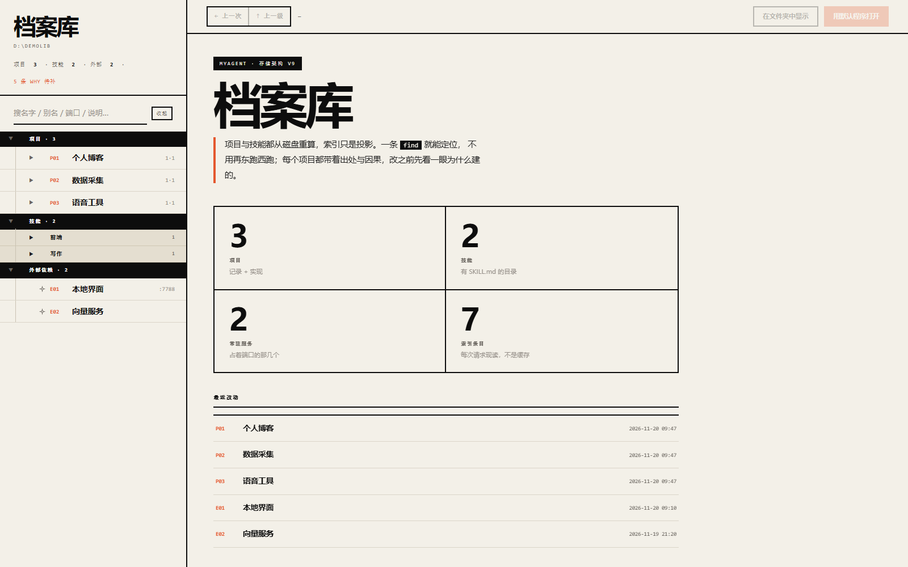

# MyAgent 存储架构（myagent-storage-architecture）

**版本：V9（2026-11-20）** · 作者：[LiMuBai-QiuWuJi](https://github.com/LiMuBai-QiuWuJi)

一套给 AI 用的本地档案库规则：**一个项目一个目录，一行数据一个条目，所有 .md 都是生成物。**
解决的问题只有一个——让「这东西在哪、叫什么、改之前该读什么」从**猜**变成**查**。

## 这个仓库是什么

```text
myagent-storage-architecture/
├─ 00-从这里开始.md      ← 先读这个
├─ 01-V9是什么.md        设计意图
├─ 02-从零搭建.md        全新搭建步骤（已有 V8 库看第二节）
├─ 03-日常使用.md        每天怎么用
├─ 05-验收清单.md        装完对着打勾
├─ 07-可视化界面.md      浏览器界面
├─ 启动界面.bat          双击起界面
├─ 模板/                 规则模板 + 记录模板
├─ 示例/                 最小可跑样例（不含任何真实数据）
├─ 脚本/                 reindex / find / serve / model（零依赖，只要 Node 18+）
└─ archive/v8/           旧版本 V8 的规则与初始化脚本（留档，不用装）
```

## 可视化界面（辅助，不是核心）



左边目录树（项目 / 技能 / 外部依赖，带条目数），中间逐级展开，右边预览代码、图片、音视频，顶上能按名字 / 别名 / 端口搜。双击 `启动界面.bat` 即开，默认 `127.0.0.1:7788`，只监听本机。

**说清楚：这个网页只是给人看的辅助视图，不是这套东西的功能本体。**

真正起作用的是——**把 `模板/Agent_Rule-模板.md`（规则文件）连同你的项目目录一起交给 AI，让它照着规则读写、检索、修改。** 界面不做写入、不做整理、不做决策，它只把磁盘上已有的东西画出来；数据全部来自 `索引/db.jsonl`，和命令行 `find` 是同一份，永远一致。你一次都不打开它，AI 该找到的东西一样能找到。

## 装起来（四步）

前置：Node.js ≥ 18；一个能读写你本地文件的 AI（Cursor / Claude Code / DeepSeek Harness 都行）。

1. **骨架落位**：把 `模板/` 与 `示例/` 里的骨架拷成你的档案库根（规则 + 示例项目 + `索引/`）
2. **工具落位**：`脚本/` 拷到 `<档案库根>/bin/`
3. **告诉 AI 根目录在哪**，跑一次重算索引
4. **双击 `启动界面.bat`**（可选，给人看的）

把包丢给 AI 时附这段话：

```text
这个包是一套本地档案库（项目 / 技能 / 外部依赖的结构化索引 + 检索工具）。
请按 02-从零搭建.md 装：骨架落位 → 工具落位 → 写根目录配置 → 跑一次重算索引，
最后双击 启动界面.bat 把界面打开。

验收（不通过就是没装成）：
1. 索引重算输出里条目数不为 0；
2. 用检索命令随便搜一个词，能命中真实条目；
3. 双击 启动界面.bat 后浏览器能打开界面。

注意：总索引和入口页都是生成物，不要手动编辑它们；要改内容就改索引数据再重建。
每一步给我实际输出。
```

三条验收都不需要装任何插件——`脚本/` 里的东西零依赖，一个 Node 就够。

## 三条硬规矩

1. **一个项目一个目录，进目录第一个文件自己会说话**：入口页是生成物，永远回答四个问题——这是什么、东西在哪、改之前读什么、边界在哪。
2. **只有一个真源，所有 .md 都是生成物**：改内容只改数据，其余视图重算即最新；条目永不搬家，暂停/废弃只写状态。
3. **先精确，后语义**：名字 / 别名 / 端口命中就返回，0 命中才降级语义搜索；查询前自愈，不用记着「定期重建」。

## 下载

- GitHub：本仓库（`git clone` 或右上角 Code → Download ZIP）
- 网盘（国内更快，内容与 GitHub 一致）：
  `https://pan.baidu.com/s/18jRnVXNy_saXC-yQG_Hojw?pwd=hgvi` 提取码 `hgvi`
- 配套的记忆架构：[myagent-memory-architecture](https://github.com/LiMuBai-QiuWuJi/myagent-memory-architecture)

## 边界

这不是「更强的模型」，是「更省的结构」：它不能提高模型能力上限，只能让你在同样的窗口里装下更多有效信息、少犯重复的错。包内不含任何个人数据，示例目录里的项目都是空的演示样例。
